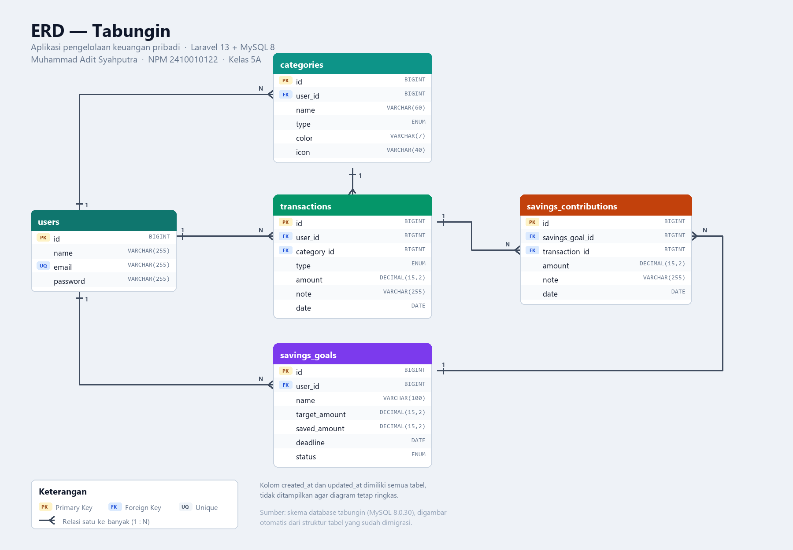

# Tabungin

Aplikasi pengelolaan keuangan pribadi berbasis **Laravel 13**. Mencatat pemasukan dan
pengeluaran, mengelompokkannya per kategori, lalu mengarahkan sisanya ke target
tabungan yang bisa disetor bertahap.

> **Tugas Project Laravel**
> Nama: **Muhammad Adit Syahputra**
> NPM: **2410010122**
> Kelas: **5A**

---

## Diagram Relasi Database



Gambar di atas tersedia di repositori dengan nama [`gambar_relasi.png`](gambar_relasi.png).
Lima tabel dengan enam relasi:

| Relasi | Jenis | Keterangan |
| --- | --- | --- |
| `users` → `categories` | 1 : N | Setiap kategori milik satu pengguna |
| `users` → `transactions` | 1 : N | Setiap transaksi milik satu pengguna |
| `users` → `savings_goals` | 1 : N | Setiap target tabungan milik satu pengguna |
| `categories` → `transactions` | 1 : N | Transaksi dikelompokkan per kategori |
| `savings_goals` → `savings_contributions` | 1 : N | Riwayat setoran tiap target |
| `transactions` → `savings_contributions` | 1 : N | Kolom `transaction_id` (opsional) menautkan setoran ke transaksi |

---

## Fitur

**Autentikasi**
- Registrasi, login, logout, dan opsi "ingat saya"
- Setiap pengguna hanya bisa melihat dan mengubah datanya sendiri

**Transaksi**
- CRUD pemasukan dan pengeluaran
- Nominal menerima format `250.000` maupun `250000`
- Filter berdasarkan jenis dan pencarian catatan
- Kategori bersifat opsional

**Kategori**
- CRUD kategori dengan warna dan ikon
- Pemisahan kategori pemasukan dan pengeluaran
- Menampilkan jumlah transaksi yang memakai kategori tersebut

**Target Tabungan**
- CRUD target dengan nominal, tenggat, dan warna penanda
- **Fitur setor**: menambah tabungan sedikit-sedikit, saldo dihitung ulang dari total setoran
- Progres otomatis berubah menjadi *Tercapai* saat saldo mencapai target
- Riwayat setoran tersimpan dan bisa dilihat di halaman ubah target

**Dashboard & Laporan**
- Ringkasan saldo, total pemasukan, dan pengeluaran
- Grafik tren enam bulan terakhir
- Pengeluaran bulan ini per kategori
- Daftar target tabungan dan transaksi terbaru
- Laporan dengan rentang tanggal bebas dan arus kas harian

**Landing page**
- Halaman publik bergaya premium dengan hero, statistik, fitur, cara kerja, dan FAQ

---

## Teknologi

| Bagian | Versi |
| --- | --- |
| Laravel | 13.39 |
| PHP | 8.3 |
| MySQL | 8.0 |
| Tailwind CSS | 4 |
| Vite | 8 |

---

## Cara Menjalankan

### 1. Siapkan database

Buat database bernama `tabungin` (lewat phpMyAdmin, Laragon, atau CLI):

```sql
CREATE DATABASE tabungin;
```

### 2. Pasang dependensi

```bash
composer install
npm install
```

### 3. Atur environment

```bash
copy .env.example .env      # Windows
cp .env.example .env        # Linux / macOS
php artisan key:generate
```

Sesuaikan bagian `DB_*` di `.env` bila kredensial MySQL kamu berbeda.

### 4. Migrasi dan isi data contoh

```bash
php artisan migrate --seed
```

### 5. Build aset frontend

```bash
npm run build
```

### 6. Jalankan

```bash
php artisan serve
```

Buka <http://127.0.0.1:8000>.

---

## Akun Demo
Data contoh sudah tersedia lewat seeder, termasuk akun siap pakai:

| | |
| --- | --- |
| Email | `demo@tabungin.test` |
| Kata sandi | `password` |

Akun ini berisi 7 kategori, 72 transaksi dalam 6 bulan, 3 target tabungan,
dan 18 riwayat setoran.

---

## Struktur Database

| Tabel | Isi |
| --- | --- |
| `users` | Data pengguna |
| `categories` | Kategori transaksi per pengguna |
| `transactions` | Pemasukan dan pengeluaran |
| `savings_goals` | Target tabungan |
| `savings_contributions` | Riwayat setoran ke target |

---

## Struktur Kode

```
app/
├── Http/
│   ├── Controllers/     Landing, Dashboard, Transaction, Category,
│   │                    SavingsGoal, Report, Auth/*
│   └── Requests/        Validasi form (pesan dalam bahasa Indonesia)
├── Models/              User, Category, Transaction, SavingsGoal,
│                        SavingsContribution
└── Support/helpers.php  rupiah(), rupiah_short(), progress_tone()

database/
├── migrations/          Skema tabel
├── factories/           Data palsu untuk pengujian
└── seeders/             Data contoh + akun demo

resources/
├── css/app.css          Design system (token, tombol, kartu, badge)
└── views/               Landing, dashboard, transaksi, kategori,
                         target, laporan, auth, komponen Blade
```

---

## Pengujian

Proyek dilengkapi **20 test** yang mencakup autentikasi, CRUD transaksi, fitur
setor tabungan, validasi, dan pencegahan akses data pengguna lain.

```bash
php artisan test
```

> Test memakai SQLite in-memory. Pastikan ekstensi `pdo_sqlite` aktif di `php.ini`.
> Bila belum, buka `php.ini` lalu hilangkan tanda `;` di depan:
> ```
> extension=pdo_sqlite
> extension=sqlite3
> ```

---

## Catatan Pengembangan

- Nominal uang disimpan sebagai `DECIMAL(15,2)` agar tidak ada galat pembulatan.
- Saldo target tabungan selalu dihitung ulang dari total setoran di dalam
  transaksi database, jadi tidak mungkin berbeda dengan riwayatnya.
- Setiap query data pengguna memakai scope `forUser()` supaya tidak ada
  kebocoran data antar pengguna.
- Form menerima nominal dengan atau tanpa pemisah ribuan (`250.000` maupun
  `250000`), dibersihkan sebelum validasi.
